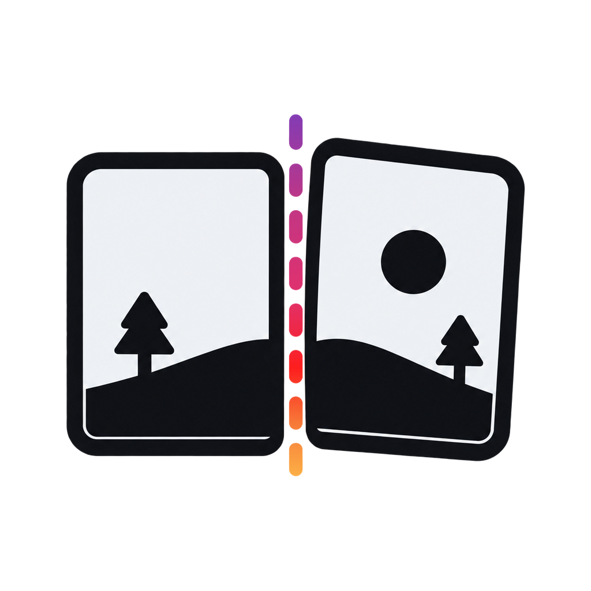
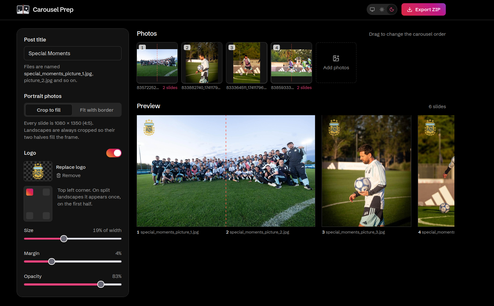
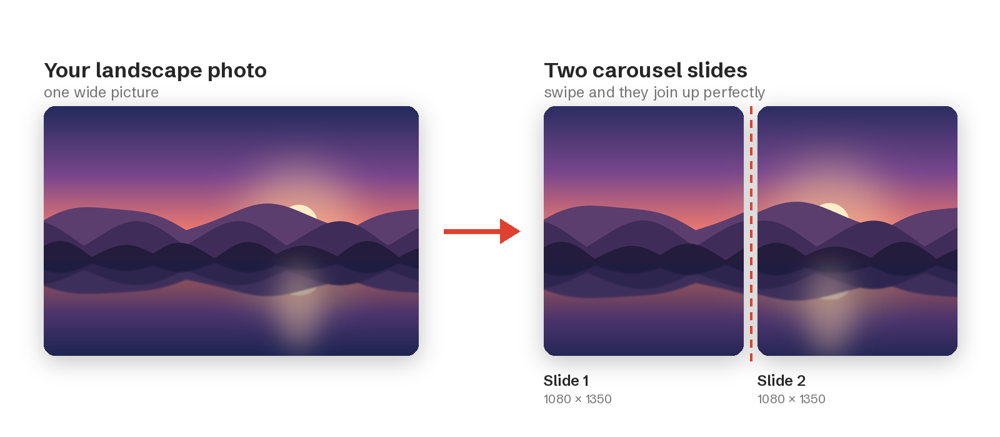

<p align="center">
  <picture>
    <source media="(prefers-color-scheme: dark)" srcset="logo/carousel-prep-icon-dark.png">
    
  </picture>
</p>

<h1 align="center">Carousel Prep</h1>

<p align="center">
  <b>Turn your photos into a scroll-stopping Instagram carousel in under a minute.</b><br>
  Split wide shots into seamless swipes, name every file, add your logo and download.
  All on your own computer.
</p>

<p align="center">
  
  
  <a href="https://hub.docker.com/r/youssefdaoud133/carousel-prep"></a>
  <a href="https://hub.docker.com/r/youssefdaoud133/carousel-prep"></a>
  <a href="https://hub.docker.com/r/youssefdaoud133/carousel-prep/tags"></a>
</p>

<p align="center">
  
</p>
<p align="center"><sub>A "Special Moments" post: two wide shots become seamless swipe pairs, the logo sits in the corner, and every slide is named and ready to upload.</sub></p>

---

## Why Carousel Prep?

You took a great wide photo: a team picture, a skyline, a beach at sunset. On Instagram it either
shows up as a thin strip or gets its sides chopped off.

Carousel Prep cuts it into **two tall slides that line up perfectly**. When your followers swipe,
the picture flows from one slide into the next as if it were one big image. It's the panorama
swipe that photographers and brands use, without spending an evening in an editing app.

<p align="center">
  
</p>

## What it does for you

- 🖼️ **Seamless panorama swipes.** Wide photos are split into two slides that match pixel for
  pixel.
- 📐 **The right Instagram size, every time.** Every slide is 1080 × 1350, the tallest shape
  Instagram allows, so your post takes up more of the screen.
- 🧍 **Portraits your way.** Fill the frame, or keep the whole photo with a white, black or
  softly blurred border.
- 🎯 **You choose what stays in.** Slide the crop window to keep the faces, the goal or the
  horizon you care about.
- ©️ **Your logo on every slide.** Pick a corner, size and transparency. On a split photo it
  appears once, not twice.
- 🏷️ **Tidy file names.** Type "Summer in Lisbon" and get `summer_in_lisbon_picture_1.jpg`,
  `_2`, `_3`… numbered in posting order.
- 👀 **See it before you post.** A live preview updates as you work, and a swipe viewer shows the
  carousel the way it looks on a phone.
- 📦 **One-click download.** Get a ZIP with a ready-to-upload folder.
- 🔒 **Private.** Your photos are processed on your own computer and never sent to an online
  service.
- 🌗 **Light or dark.** Follows your system setting, or pick one yourself.

## Who it's for

Photographers · travel and food creators · social media managers · small businesses and shops ·
sports clubs and teams · event organisers · anyone who wants their posts to look polished.

---

## Get started (about 5 minutes, no coding)

Carousel Prep runs inside **Docker**, a free app that runs this tool for you so there is nothing
else to install. The app is published on
[Docker Hub](https://hub.docker.com/r/youssefdaoud133/carousel-prep) and works on Windows, Mac
(Intel and Apple Silicon) and Linux.

1. **Install Docker Desktop** from [docker.com](https://www.docker.com/products/docker-desktop/)
   and open it once. Wait until it says it is running.
2. **Open a terminal.**
   - **Windows:** open the Start menu, type `PowerShell` and press Enter.
   - **Mac:** open **Terminal** (press <kbd>⌘</kbd> + <kbd>Space</kbd> and type "Terminal").
   - **Linux:** open your Terminal app.
3. **Paste this command and press Enter.** The first time, Docker downloads the app from
   Docker Hub (about 90 MB):
   ```bash
   docker run -d --name carousel-prep -p 8080:8080 --restart unless-stopped youssefdaoud133/carousel-prep
   ```
4. **Open [http://localhost:8080](http://localhost:8080)** in your browser. That's it! 🎉

It keeps running in the background and starts again with Docker Desktop, so next time just
open the link.

| To… | Run |
| --- | --- |
| Stop it | `docker stop carousel-prep` |
| Start it again | `docker start carousel-prep` |
| Update to the newest version | `docker rm -f carousel-prep && docker pull youssefdaoud133/carousel-prep`, then step 3 again |

> Port 8080 already in use? Change the first number, e.g. `-p 9000:8080`, then open
> `http://localhost:9000`.

## Make your first carousel

1. **Drop your photos** anywhere on the page, or click **choose files**.
2. **Drag the cards** into the order you want people to swipe through.
3. **Type your post title.** It becomes the file names.
4. **Pick a look for portraits:** *Crop to fill* or *Fit with border*.
5. **Add your logo** (optional): switch on **Logo**, upload a PNG and choose the corner.
6. **Click any preview slide** to swipe through your carousel.
7. **Click Export ZIP**, then upload the slides to Instagram in number order.

> 💡 **Tip:** in Instagram, tap the "select multiple" icon and pick the photos in order:
> `picture_1`, `picture_2`, `picture_3`… That's your carousel, exactly as previewed.

## Questions

<details>
<summary><b>Are my photos uploaded to the internet?</b></summary>

No. Carousel Prep runs on your own computer. Photos are kept only while you work and are cleared
automatically.
</details>

<details>
<summary><b>Will my photos lose quality?</b></summary>

Slides are saved as high-quality JPEGs (quality 95, full colour detail). Instagram compresses
every upload, and starting from the best possible file gives the sharpest result on the feed.
</details>

<details>
<summary><b>How much of a wide photo gets cut off?</b></summary>

A typical camera photo loses about 6% at the top and bottom, and a phone's widescreen photo about
10% at the sides. You can move the crop to keep what matters.
</details>

<details>
<summary><b>Which photos can I use?</b></summary>

JPG, PNG, WebP and iPhone HEIC photos, up to 50 MB each and 40 per post. Instagram allows up to
20 slides per carousel, and the app warns you if you go over.
</details>

<details>
<summary><b>Why are all slides the same shape?</b></summary>

Instagram gives every slide in a carousel the shape of the first one. Carousel Prep makes them
all 4:5 (1080 × 1350), the tallest shape Instagram allows, so nothing gets cropped unexpectedly.
</details>

<details>
<summary><b>Can I use it from my phone?</b></summary>

Yes, as long as your phone is on the same Wi-Fi as the computer running it. Open
`http://<your-computer's-IP-address>:8080` in your phone's browser.
</details>

---

## For developers

<details>
<summary><b>Tech stack, how it works, API and local development</b></summary>

### Stack

| Part | Tech |
| --- | --- |
| `frontend/` | React 19, TypeScript 7, Vite 8, Tailwind CSS 4, dnd-kit; built into the image and served by the API |
| `backend/` | Python 3.15, FastAPI, Pillow 13, pillow-heif; managed with uv |

One Docker image runs a single Python process that serves both the API (`/api/*`) and the built
web app. Uploads live in a temporary per-browser session (cleared after 2 hours idle); nothing is
written outside the container.

### Build and run from source

```bash
docker compose up --build          # http://localhost:8080 (PORT=9000 to change)
```

Without `--build`, `docker compose up` pulls the published image from Docker Hub instead.

### Publishing to Docker Hub

The image is published as
[`youssefdaoud133/carousel-prep`](https://hub.docker.com/r/youssefdaoud133/carousel-prep) for
`linux/amd64` and `linux/arm64`, tagged with the full version, the minor version and `latest`.

**Automatically (recommended):** pushing a version tag runs
[`.github/workflows/docker-publish.yml`](.github/workflows/docker-publish.yml), which builds both
platforms on GitHub and pushes them:

```bash
git tag v1.1.0 && git push origin v1.1.0   # -> :1.1.0, :1.1 and :latest
```

It needs two repository secrets: `DOCKERHUB_USERNAME` and `DOCKERHUB_TOKEN` (a Docker Hub access
token with Read & Write permission).

**Manually:** after `docker login`, from the repository root:

```bash
# once per boot, if this machine can't build ARM images yet
docker run --privileged --rm tonistiigi/binfmt:qemu-v10.2.3 --install arm64

docker buildx build --platform linux/amd64,linux/arm64 \
  -t youssefdaoud133/carousel-prep:1.1.0 \
  -t youssefdaoud133/carousel-prep:1.1 \
  -t youssefdaoud133/carousel-prep:latest \
  --push .
```

If the upload drops partway, run the same command again: already uploaded layers are skipped.

### Image processing

- A landscape is center-cropped to 8:5 (two 4:5 slides side by side), resized to 2160 × 1350
  with Lanczos resampling and cut down the middle, so the halves join pixel for pixel.
- Portraits are center-cropped to 4:5, or fitted onto a white, black or blurred background.
- Photos are auto-rotated using EXIF orientation and converted to sRGB. Output is JPEG at
  quality 95 with 4:4:4 chroma and an embedded sRGB profile.
- The logo is placed on every portrait slide, and on one half of a split landscape: the first
  half for left corners, the second half for right corners.

### API

| Method | Path | Purpose |
| --- | --- | --- |
| `POST` | `/api/sessions` | Start a session |
| `POST` | `/api/sessions/{id}/images` | Upload photos (multipart `files`) |
| `GET` | `/api/sessions/{id}/images/{image}/thumb` | Thumbnail |
| `DELETE` | `/api/sessions/{id}/images/{image}` | Remove a photo |
| `PUT` / `DELETE` | `/api/sessions/{id}/logo` | Set or remove the logo |
| `POST` | `/api/sessions/{id}/preview` | Render small preview slides |
| `POST` | `/api/sessions/{id}/export` | Render full-size slides as a ZIP |

### Development without Docker

```bash
# API on :8000
cd backend && uv run carousel-prep

# UI on :5173 (proxies /api to :8000)
cd frontend && npm install && npm run dev
```

Tests and lint:

```bash
cd backend && uv run pytest && uv run ruff check . && uv run ruff format --check .
cd frontend && npm run build && npm run lint
```

### Logo assets

The source artwork is `logo/Split Panorama Carousel Icon.png`. Every derived file (cleaned icon,
dark-mode version, header logo, favicon, home-screen and manifest icons) is generated from it:

```bash
uv run --project backend python logo/build_assets.py
```

</details>
